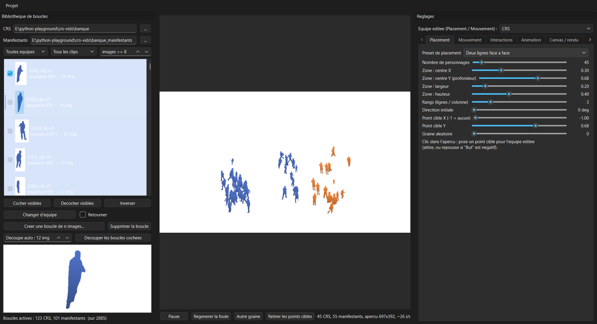
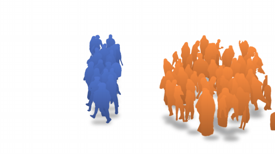
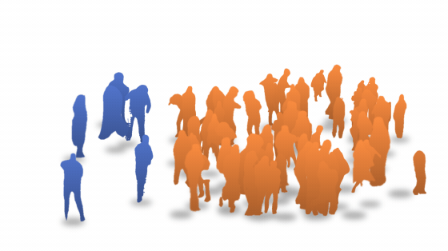

# Foule

Application de bureau (PySide6) pour **créer des foules animées à partir de séquences de personnages détourés** (EXR RGBA),
avec des boids qui interagissent entre deux équipes (ex. police / manifestants), et exporter le résultat en vidéo, GIF ou séquence PNG.
Le projet contient aussi la chaîne de **détourage automatique** qui produit ces séquences à partir de vidéos.

> **Aucune donnée n'est fournie** : ni vidéos sources, ni séquences détourées. Les captures et GIF ci-dessous utilisent le mode
> anonymisé (`FOULE_ANON=1`) : les personnages y sont remplacés par des silhouettes unies. Utilisez uniquement des sources dont vous
> avez les droits (droit d'auteur, droit à l'image, RGPD).



| Un manifestant, tous les CRS à ses trousses | Nasse |
|---|---|
|  |  |
| **Cordon qui repousse la foule** | **Contagion (capture → conversion)** |
|  |  |

## Fonctions

- Import automatique de tous les dossiers de séquences EXR d'une banque (deux banques : équipe 0 et équipe 1), cases à cocher, aperçu animé, vignettes en cache.
- Boucles : choix des séquences actives, création de **boucles de n images** (coupe nette, ping-pong, fondu enchaîné, inverse) même imparfaites, découpe automatique en morceaux de n images.
- Simulation de boids (séparation / alignement / cohésion, but, rotation, errance, courant, profondeur) avec presets de placement et de mouvement.
- **Stabilité** : ancrage vers le point d'origine, rayon de liberté, amortissement, lissage, force de pilotage max.
- **Interactions entre équipes** : poursuivre le plus proche, cible unique, encercler, fuir, éviter, escorter, barrer la route ; effets au contact (ralentir, figer, retirer, convertir) ; 10 scénarios prêts à l'emploi.
- Animation des boucles : fluide, saccadé (stop motion), ping-pong, aléatoire, pose figée ; perspective selon la profondeur ; ombres.
- Canvas qui suit la résolution de rendu ; fond blanc par défaut, transparent ou image.
- Export : MP4 H.264 / H.265, WebM VP9 transparent, ProRes 4444 / 422, GIF, séquence PNG ; 4K, 1080p, 720p web…

## Installation

```bash
pip install -r requirements.txt
```
FFmpeg doit être dans le PATH (export vidéo). Lancer l'application : `python -m foule` (ou `lancer_foule.bat`).
Par défaut elle lit les séquences dans `banque/` et `banque_manifestants/` à côté du script ; changez les dossiers dans l'interface.

## Produire des séquences détourées

```bash
python detourer.py --clips brut/mon_clip.mp4 --classes police,manif   # détoure les personnages entiers
python trier_banque.py banque_manifestants --garde civil              # reclasse (CLIP) et écarte les intrus
python trier_banque.py banque --garde police
```
`detourer.py` : détection + suivi (YOLO11), classement police / civil / presse (CLIP), masques (SAM 2), sortie EXR DWAA RGBA.
Les poids (`yolo11x.pt`, `sam2.1_b.pt`) sont téléchargés par ultralytics. `trier_banque.py` ne supprime rien : les séquences écartées vont dans `.ecartes/`.

## Mode anonymisé

`FOULE_ANON=1 python -m foule` remplace tous les personnages (aperçu, vignettes, export) par des silhouettes unies aux couleurs de leur équipe.

## Licence

AGPL-3.0 (le détourage utilise ultralytics, sous AGPL-3.0). Voir `LICENSE`.
